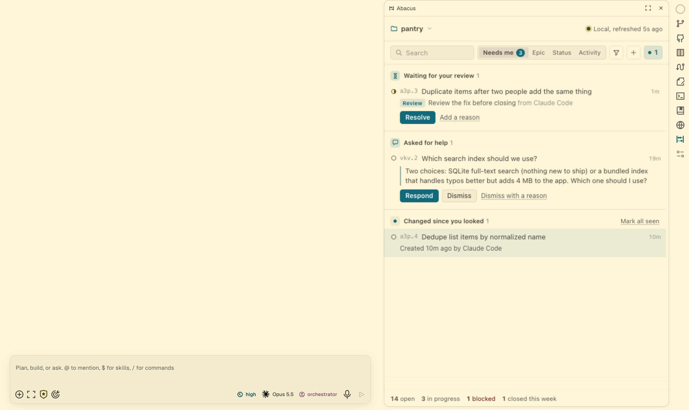
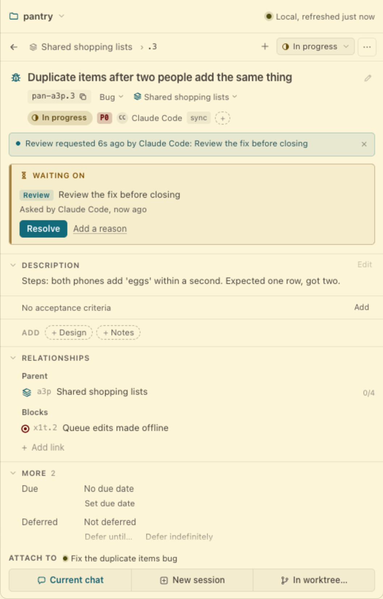
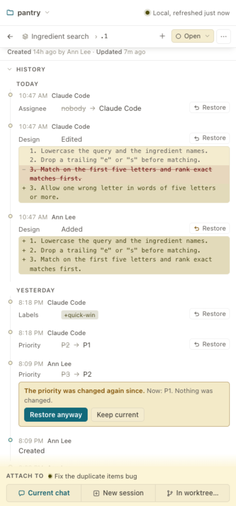
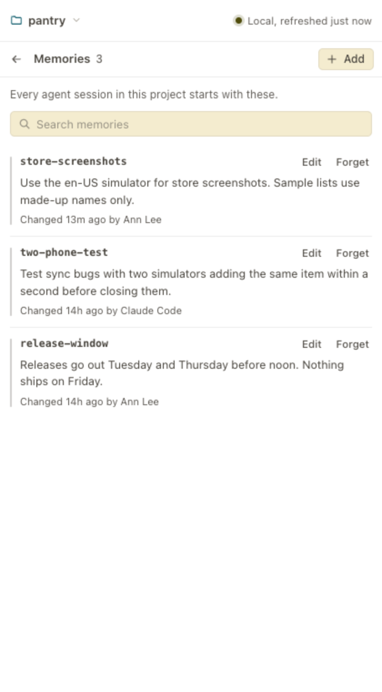
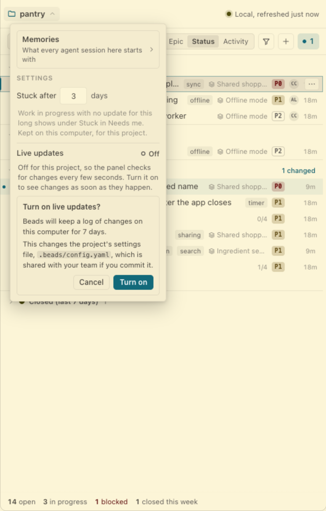
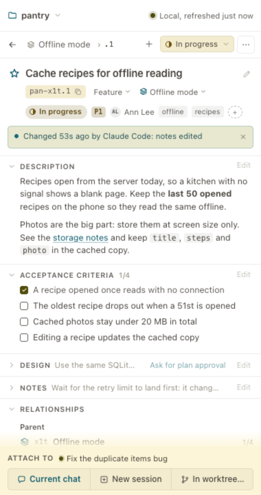
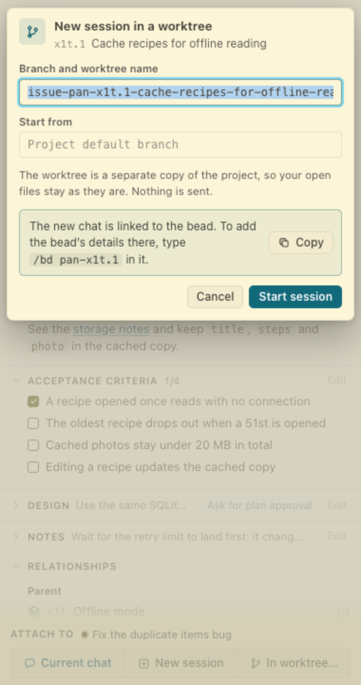

# <picture><source media="(prefers-color-scheme: dark)" srcset="docs/logo/lockup-dark.svg"></picture>

Abacus is an OpenChamber extension that shows a project's [Beads](https://github.com/gastownhall/beads) issues in the right-rail panel, next to your agent. You can browse, search, edit and create beads, see what your agent changed, and hand a bead to a chat or a new session. You do not need the `bd` command line to do any of it.

In this documentation, "Beads" is the tool and "beads" are the issues it tracks.

[Watch it as video](docs/demo.mp4)

## What it does

- **Needs me.** What waits on you: reviews and plan approvals, requests for help from an agent, beads stuck in progress, and what changed since you looked. Resolve, approve, respond and defer from the row.
- **Epic and Status views.** Beads grouped under their epic, or by status (In progress, Blocked, Ready, Deferred, Closed). Custom statuses show up too.
- **Search and filters.** Search by id or title. Filter by status, assignee, priority, and "Only ready to start".
- **Activity.** A feed of what changed, who changed it, and when. Changes you have not looked at yet are marked, and the rail icon shows a count.
- **Reviews.** Ask for a review or for approval of a plan. A bead that waits shows what it waits on, and cannot close until someone resolves it. Agents see the same reviews.
- **History and Restore.** A bead's earlier versions, and a restore that puts a field back after checking it against the bead as it is now.
- **Memories.** The notes every agent session in the project starts with: list, add, edit, forget and undo.
- **Edit in place.** Title, description, acceptance criteria (with ticks), design, notes, status, priority, assignee, labels, due and defer dates, type, parent epic, links between beads, and comments. Close a bead with a comment, or as superseded or a duplicate. If a bead changed while you were editing, you are asked before anything is overwritten.
- **Live updates.** With Beads 1.3, follow changes as they happen instead of every few seconds. Off until you turn it on in the project menu.
- **Create.** A "New bead" form with type, priority, parent and description.
- **Hand to the agent.** Put a bead on the open chat as a chip, start a new session linked to it, or start one in a new worktree. Nothing is sent until you send it.
- **Team sync.** For projects with a shared copy, Sync brings in the team's changes and Publish sends yours, after you review the list.

## Screenshots

Needs me puts what waits on you first: reviews to resolve, questions from your agent, and what changed since you looked.

<table>
  <tr>
    <td width="33%"></td>
    <td width="33%"></td>
    <td width="33%"></td>
  </tr>
  <tr>
    <td>A bead that waits on a review says so, and you resolve it from there.</td>
    <td>History shows each change. Restore checks the bead first and changes nothing if it moved on.</td>
    <td>Memories: what every agent session in the project starts with.</td>
  </tr>
  <tr>
    <td></td>
    <td></td>
    <td></td>
  </tr>
  <tr>
    <td>Live updates ask first, and say what they change.</td>
    <td>Bead detail, with Attach to for the chat or a new session.</td>
    <td>Start a session on a bead in its own worktree.</td>
  </tr>
</table>

More screenshots are in the [user guide](docs/user-guide.md). Each one has a dark version in [docs/screenshots](docs/screenshots/).

## Requirements

- OpenChamber 2.3.2 or newer.
- `bd` 1.3.1 (tested against a real install) or 1.2.2 (covered by tests on captured 1.2.2 output). Other versions are not checked. Live updates need 1.3 or later. On 1.2.2 everything else works and the panel checks for changes every few seconds.
- `git`.
- `dolt`, for projects in Beads' embedded mode. Without it the panel still lists beads and Sync still works, but most changes show an unknown author and Publish cannot run.

The panel looks for `bd`, `dolt` and `git` on the PATH and in `/opt/homebrew/bin`, `/usr/local/bin`, `~/.local/bin` and `~/go/bin`, so it works when OpenChamber is started from the Dock.

## Install

Needs [OpenChamber](https://github.com/openchamber/openchamber) 2.3.2 or later and [Beads](https://github.com/gastownhall/beads) (`brew install beads`).

1. In OpenChamber, open **Settings**, then **Extensions**.
2. Paste `https://github.com/lantzleiweke/abacus` and press **Add**.
3. Press **Allow and enable**, then open Abacus from the rail.

New versions show up on the same screen as an **Update** button. Installing for a team in enterprise mode, pinning a version, or running your own copy: see [troubleshooting](docs/troubleshooting.md#installing) and [development](docs/development.md).

## First run

Open a project that already uses Beads. The panel reads it and shows the list. A project that does not use Beads, or that needs a newer or older `bd`, shows a message that says what to do. See [troubleshooting](docs/troubleshooting.md).

If a newer `bd` than the one that last opened the project is installed, the panel asks "Open this project with Beads X?" once before it runs anything in the project.

## What it never does

- It never changes Beads' configuration or data format on its own. It never calls `bd dolt remote add`. Two buttons change Beads, and each asks first. **Turn on live updates** writes the events journal setting in `.beads/config.yaml`. **Update project** updates a project made with an older Beads to the newer data format, once, and never starts by itself.
- It never forces anything. It does not pass `--force`, and when Beads refuses to close a bead, for example because it waits on a review, the panel shows the refusal.
- It never publishes without your click. Publish shows what would go out, and goes only after you confirm.
- It never overwrites a change it did not show you. Every edit, and every restore, is checked against the bead as it was when you opened it. A memory is changed or forgotten only when its text is still the text you saw.
- It never starts the Beads server for you.
- It never sends anything to a chat on its own. Attaching puts a chip on the composer. You send it.

## Known limits

- With Beads 1.3, History and Activity name who made a change only when it was made on this computer. A close and a reopen are never named in History.
- The live-updates log is per computer, but the setting lives in `.beads/config.yaml`, so it reaches teammates if that file is committed.
- **Update project** is untested on projects that share their beads through a team copy or a server, and Beads refuses to update those in place, so the panel tells you to ask whoever set up the team copy. A very large project may take longer than the two minutes the update is given, and then the panel asks you to check again.
- On a project whose history was flattened, History shows some entries without a time.
- Memories, the read of who holds a bead, and Live updates are untested for server-mode projects.
- A chip cannot follow a worktree start. OpenChamber closes the panel when the new session opens, so the bead cannot be added to that chat automatically. The confirmation shows the `/bd <id>` command to type in the new chat.
- The attach picker adds one bead each time it is opened.
- Publish needs a team copy that already has something in it. Publishing into an empty team copy for the first time is a one-time setup step for your agent.
- Beads in server mode that stop partway through a merge are handled on a best-effort basis. That path has been tested against a simulated half-merge, not a real one over git and https.
- Sync and Publish run with the environment OpenChamber gives extensions. That includes `HOME`, so stored Git credentials work. It does not include `SSH_AUTH_SOCK`, so use an SSH key that needs no agent (set up in `~/.ssh/config`) or an HTTPS remote with stored credentials.

Each known limit has an [issue](https://github.com/lantzleiweke/abacus/issues), and the [Roadmap](https://github.com/lantzleiweke/abacus/issues/18) lists what is planned. The reasoning behind each limit is in [decisions](docs/decisions.md#deferred).

## Documentation

- [User guide](docs/user-guide.md): every view and action.
- [Architecture](docs/architecture.md): how the panel, the service and Beads fit together.
- [Development](docs/development.md): setup, scripts, preview server, tests.
- [Troubleshooting](docs/troubleshooting.md): each message the panel shows, its cause and fix.
- [Decisions](docs/decisions.md): why it works the way it does.
- [Changelog](CHANGELOG.md)
- [All docs](docs/README.md)
