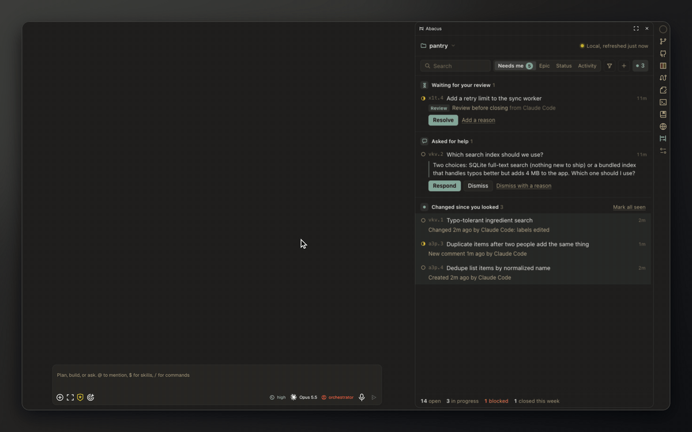
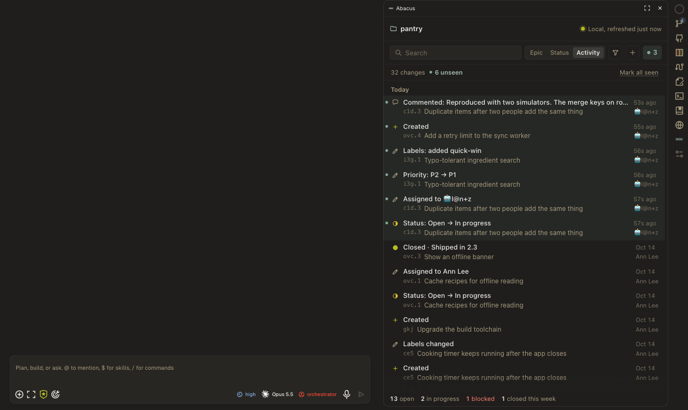

# Abacus

Abacus is an OpenChamber extension that shows a project's [Beads](https://github.com/steveyegge/beads) issues in the right-rail panel, next to your agent. You can browse, search, edit and create beads, see what your agent changed, and hand a bead to a chat or a new session. You do not need the `bd` command line to do any of it.

In this documentation, "Beads" is the tool and "beads" are the issues it tracks.

[Watch it as video](docs/demo.mp4)

## What it does

- **Epic and Status views.** Beads grouped under their epic, or by status (In progress, Blocked, Ready, Deferred, Closed). Custom statuses show up too.
- **Search and filters.** Search by id or title. Filter by status, assignee, priority, and "Only ready to start".
- **Activity.** A feed of what changed, who changed it, and when. Changes you have not looked at yet are marked, and the rail icon shows a count.
- **Edit in place.** Title, description, acceptance criteria, design, notes, status, priority, assignee, labels, links between beads, and comments. If a bead changed while you were editing, you are asked before anything is overwritten.
- **Create.** A "New bead" form with type, priority, parent and description.
- **Hand to the agent.** Put a bead on the open chat as a chip, start a new session linked to it, or start one in a new worktree. Nothing is sent until you send it.
- **Team sync.** For projects with a shared copy, Sync brings in the team's changes and Publish sends yours, after you review the list.

## Screenshots

Activity shows who changed what; the agent's edits are marked unseen.

<table>
  <tr>
    <td width="33%"></td>
    <td width="33%"></td>
    <td width="33%"></td>
  </tr>
  <tr>
    <td>Epic view: unseen beads highlighted, team sync line on top.</td>
    <td>Start a session on a bead in its own worktree.</td>
    <td>Bead detail, with Attach to for the chat or a new session.</td>
  </tr>
  <tr>
    <td></td>
    <td></td>
    <td></td>
  </tr>
  <tr>
    <td>Closing a bead asks for an optional reason.</td>
    <td>Publish lists every change before it goes out.</td>
    <td>A sync conflict shows both sides. Hand it to your agent.</td>
  </tr>
</table>

More screenshots are in the [user guide](docs/user-guide.md). Each one has a dark version in [docs/screenshots](docs/screenshots/).

## Requirements

- OpenChamber 2.3.2 or newer.
- `bd` 1.2.2 or newer. 1.2.2 is the version this was tested against.
- `git`.
- `dolt`, for projects in Beads' embedded mode. Without it the panel still lists beads and Sync still works, but most changes show an unknown author and Publish cannot run.

The panel looks for `bd`, `dolt` and `git` on the PATH and in `/opt/homebrew/bin`, `/usr/local/bin`, `~/.local/bin` and `~/go/bin`, so it works when OpenChamber is started from the Dock.

## Install

1. `npm install && npm run build`
2. In OpenChamber: Settings, Extensions, Add. Paste this folder's absolute path.
3. Approve the capabilities and open the Abacus panel from the rail.

The built files are committed, so a checkout without `npm run build` also installs. See [development](docs/development.md) for why.

OpenChamber in enterprise mode only allows extensions that run a service from repositories an admin has listed, or from local folders. Abacus runs a service, so install it from a local folder or ask an admin to list its repository.

## First run

Open a project that already uses Beads. The panel reads it and shows the list. A project that does not use Beads, or that needs a newer or older `bd`, shows a message that says what to do. See [troubleshooting](docs/troubleshooting.md).

If a newer `bd` than the one that last opened the project is installed, the panel asks "Open this project with Beads X?" once before it runs anything in the project.

## What it never does

- It never changes Beads' configuration. It never calls `bd dolt remote add` or anything else that writes `.beads/config.yaml`.
- It never forces anything. It does not pass `--force`, and when Beads refuses to close a bead, the panel shows the refusal.
- It never publishes without your click. Publish shows what would go out, and goes only after you confirm.
- It never overwrites a change it did not show you. Every edit is checked against the bead as it was when you opened it.
- It never starts the Beads server for you.
- It never sends anything to a chat on its own. Attaching puts a chip on the composer. You send it.

## Known limits

- A chip cannot follow a worktree start. OpenChamber closes the panel when the new session opens, so the bead cannot be added to that chat automatically. The confirmation shows the `/bd <id>` command to type in the new chat.
- The attach picker adds one bead each time it is opened.
- Publish needs a team copy that already has something in it. Publishing into an empty team copy for the first time is a one-time setup step for your agent.
- Beads in server mode that stop partway through a merge are handled on a best-effort basis. That path has been tested against a simulated half-merge, not a real one over git and https.
- Sync and Publish run with the environment OpenChamber gives extensions. That includes `HOME`, so stored Git credentials work. It does not include `SSH_AUTH_SOCK`, so use an SSH key that needs no agent (set up in `~/.ssh/config`) or an HTTPS remote with stored credentials.

Each known limit has an [issue](https://github.com/lantzleiweke/abacus/issues), and the [Roadmap](https://github.com/lantzleiweke/abacus/issues/18) lists what is planned. The reasoning behind each limit is in [decisions](docs/decisions.md#deferred).

## Documentation

- [User guide](docs/user-guide.md): every view and action.
- [Architecture](docs/architecture.md): how the panel, the service and Beads fit together.
- [Development](docs/development.md): setup, scripts, preview server, tests.
- [Troubleshooting](docs/troubleshooting.md): each message the panel shows, its cause and fix.
- [Decisions](docs/decisions.md): why it works the way it does.
- [Changelog](CHANGELOG.md)
- [All docs](docs/README.md)
