# User guide

This guide covers everything the Abacus panel shows and does. Quoted text is what the panel displays. For a message that stops you, see [troubleshooting](troubleshooting.md).

"Beads" is the tool. "beads" are the issues it tracks. A bead id looks like `myproj-a1b2`. The panel shows the short form (`a1b2`) in lists.

## Contents

1. [The panel at a glance](#the-panel-at-a-glance)
2. [Header lines](#header-lines)
3. [Epic and Status views](#epic-and-status-views)
4. [Search and filters](#search-and-filters)
5. [Keyboard](#keyboard)
6. [Opening a bead](#opening-a-bead)
7. [Editing](#editing), including due and defer, moving, acceptance ticks, superseding and closing
8. [Creating a bead](#creating-a-bead)
9. [Giving a bead to your agent](#giving-a-bead-to-your-agent)
10. [Unseen changes and the rail badge](#unseen-changes-and-the-rail-badge)
11. [Activity](#activity)
12. [Needs me](#needs-me)
13. [Waiting on and reviews](#waiting-on-and-reviews)
14. [History and Restore](#history-and-restore)
15. [Memories](#memories)
16. [Project menu](#project-menu): Stuck days and Live updates
17. [Sync and Publish](#sync-and-publish)
18. [A project that needs a one-time update](#a-project-that-needs-a-one-time-update)
19. [When a project cannot be shown](#when-a-project-cannot-be-shown)

## The panel at a glance

Open the Abacus icon in the right rail. The panel follows the project OpenChamber has open. From top to bottom:

- **Header.** The project name (or "Abacus" when no project is open) and two status lines. The project name opens the [project menu](#project-menu).
- **Tools row.** A search box, the view switcher (Needs me, Epic, Status, Activity), a filters button, a New bead (+) button, and an unseen chip when something changed.
- **The list**, or the bead you opened.
- **Footer.** Counts: open, in progress, blocked, closed this week.

Your view, filters and which groups are folded are remembered per project. The search text is not.

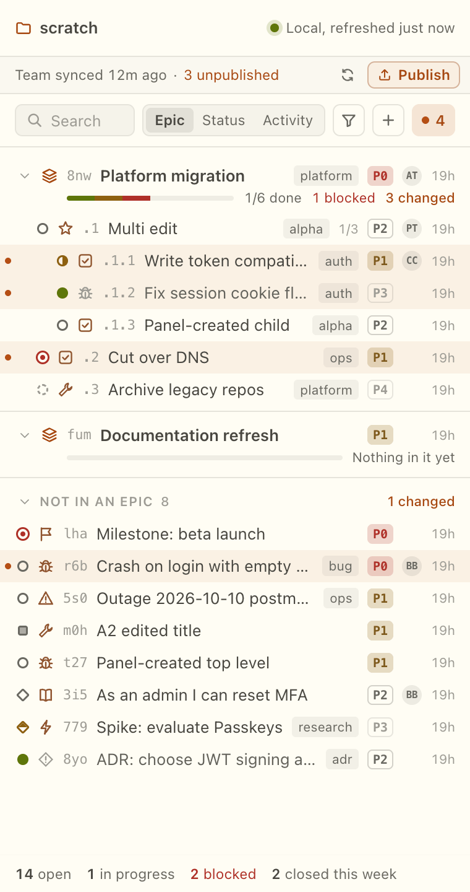

## Header lines

The first line says how fresh the local copy is:

- "Local, refreshed 8s ago". The age reads "just now", "8s ago", "12m ago", "3h ago", "2d ago" or "3w ago".
- "Local, not refreshed yet". The first read has not finished.

For a project that has a shared copy with the team, a second line shows:

- "Team synced 12m ago" or "Team not synced yet". The time is the last Sync or Publish run from the panel, remembered across restarts. A sync your agent runs is not counted.
- "N unpublished". Changes on this computer the team's copy does not have yet.
- "Unpublished count unavailable". The count could not be read. Sync and Publish still work.

The team line is absent for a project with no shared copy.

If nothing has been read for 30 seconds, or the last read failed, a banner appears: "Beads hasn't answered for a while." when no more specific reason is known. It has **Copy details** and **Retry**. The panel keeps retrying by itself, with longer waits after repeated failures (up to 30 seconds).

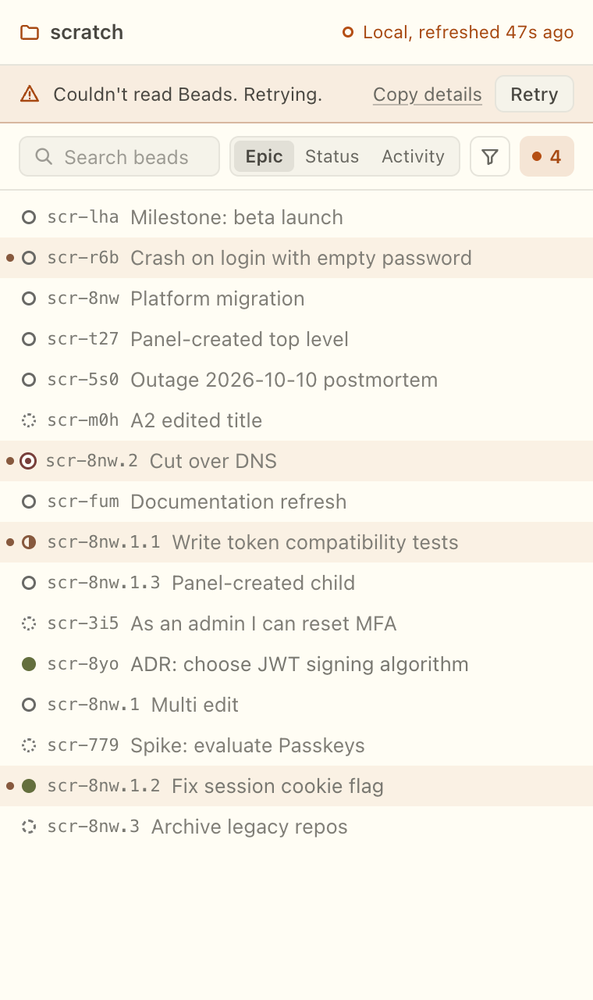

## Epic and Status views

**Epic.** Beads nest under their epic, and sub-epics nest under theirs. Beads that belong to no epic fall in a trailing "Not in an epic" group. An epic row shows its progress as sub-issues done of total. Click a group header to fold it.

**Status.** Beads group by status:

| Section | What goes in it |
|---|---|
| In progress | Status in progress. |
| Blocked | Open beads that are not ready, and beads with the blocked status. These read "Waiting on another bead". |
| Ready | Open beads with nothing blocking them. |
| Deferred | Open beads with a defer date in the future. These read "Deferred until later". |
| Closed | Done beads. Under the default filter it reads "Closed (last 7 days)". |

A project's custom statuses get their own sections. The panel capitalizes them for display and shows the raw name on hover. A custom status that counts as done is treated like Closed.

Deferred and Closed start folded. A section with more than 8 rows shows 6 and a "Show N more" link.

Each row shows the status icon (in the Status view it moves to the section header), the type, the short id, the title, up to two labels, the parent epic in the Status view, sub-issue progress, a priority chip (P0 to P4), the assignee's initials, and how long ago it was updated.

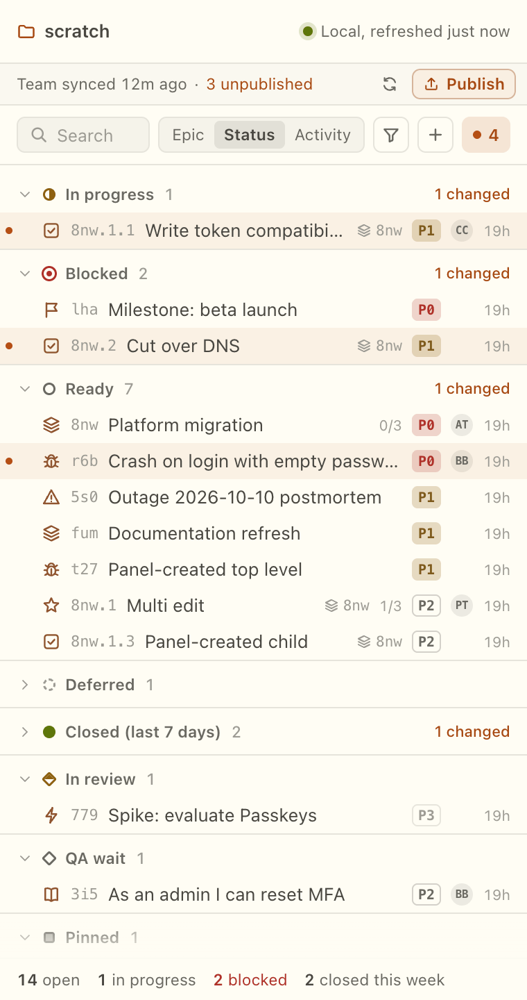

### Row menu

Open a row's menu with the "More actions" button at its right end, a right click, or the Menu key on a focused row:

- **Add to current chat.** Disabled with "No open chat" when OpenChamber has no chat open.
- **Start session.**
- **Start in worktree…**
- **Copy ID.**

The first three are disabled while another of them is running. See [Giving a bead to your agent](#giving-a-bead-to-your-agent).

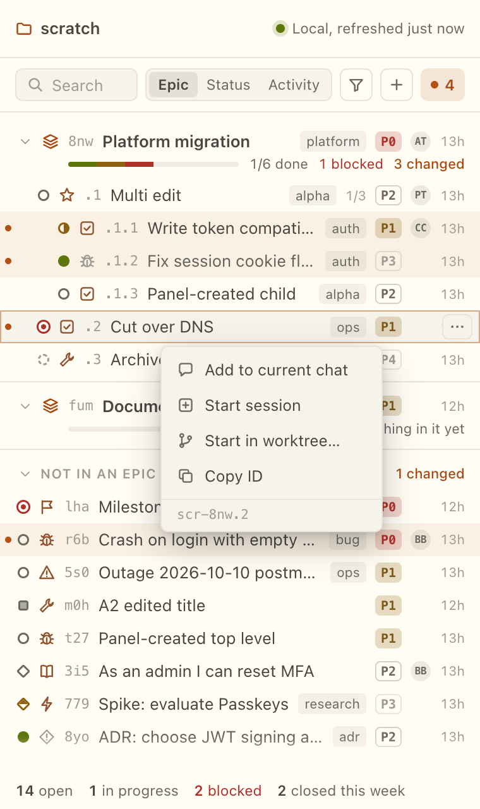

## Search and filters

Type in the search box. What you type must appear in the bead's id or title, as one piece of text (the attach picker, below, matches word by word instead). While a search is active, folded groups open and long sections show every row. The placeholder reads "Search beads" in the list and "Search activity" in Activity. When the unseen chip is visible it reads "Search".

The filters button opens:

- **Status.** "Current" (the default: "Everything not done, plus what closed in the last 7 days"), "All", or any set of individual statuses.
- **Assignee.** "Anyone", "Unassigned", or a name.
- **Priority.** Any of P0 to P4.
- **Due.** "Overdue" and "Due this week". See [Due, snooze and defer](#due-snooze-and-defer).
- **Ready.** "Only ready to start": "Open beads with nothing blocking them".
- **Reset filters.**

Filters apply to the Epic and Status views. The filter panel notes this: "Filters apply to the Epic and Status views. Activity shows every change; search narrows it."

When nothing shows:

- "Only older closed beads match." with "They closed more than 7 days ago." and a **Show all** button. This is the default filter hiding them.
- "No beads match." with "Nothing has that id or title." (a search) or "Nothing fits these filters." Buttons: **Clear search**, **Reset filters**.
- "No beads in this project yet." with "When your agent creates beads, they show up here within a few seconds."

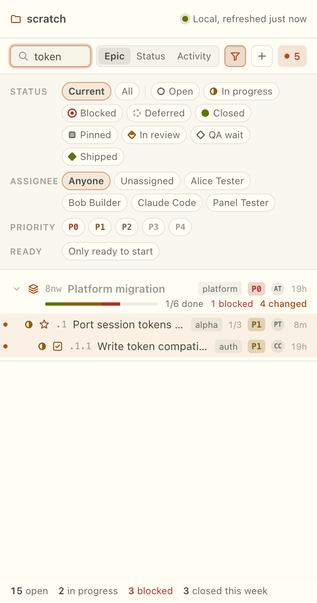

## Keyboard

In the list:

| Key | Does |
|---|---|
| `j` or Down | Move the cursor down. |
| `k` or Up | Move the cursor up. |
| Enter | Open the bead under the cursor. |
| `/` | Go to the search box. |
| Menu key | Open the row menu. |
| Esc | Back out: clear, close, or leave the bead. |

In the search box, letters are text. The arrow keys still move the cursor and Enter opens the cursor row. In any other text field every key is yours.

Saving a text edit uses Cmd+Enter on a Mac and Ctrl+Enter elsewhere. The editor's hint shows the right one. In the attach picker, Up and Down (or Ctrl+N and Ctrl+P) move, Enter attaches, and Esc clears the search and then closes.

## Opening a bead

Click a row, or press Enter on it. The bead replaces the list. **Back** (or Esc) returns, and the row stays selected. Opening a bead from its relationships stacks the detail views, and Back steps through them.

**Top bar.** Back, the epic it belongs to, New bead, and the status menu.

**Header.** The title (with an Edit title button), "Copy ID", the type, a status pill, a priority menu, the assignee picker, labels, and "+ Label". When the bead cannot start yet you see "Waiting on …". A deferred bead shows "Deferred until …".

**Change banner.** If the bead changed since you last looked, a banner reads "Change since you last looked" and says what changed. **Dismiss** hides it.

**Sections.**

- **Description.** Rendered Markdown. Links open outside the panel. A link the panel cannot open (a relative path, a file link) is offered as text with Copy.
- **Acceptance criteria.** Checkbox items.
- **Design** and **Notes.** Start folded.
- **Relationships.** Linked beads and children, with how many children are done. A linked bead that is not in the project reads "Not in this project". Kinds: Blocked by, Blocks, Related, Discovered from, Tracks, Caused by, Validates, Supersedes.
- **More.** Other fields the bead carries.
- **Activity.** Comments, a comment box, and the Created, Updated, Closed and Reason stamps.

Empty parts are not drawn. An "Add" row of chips (Description, Acceptance, Design, Notes, Link) lets you start one.

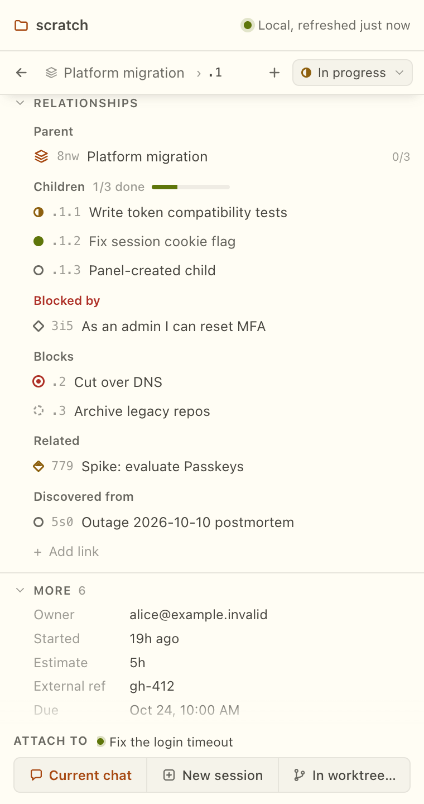

If the bead cannot be read, the detail shows an error with **Try again**. If the bead is gone from the project, it says "This bead is no longer in the project. This is the last copy read."

## Editing

Edit from the detail view. Everything below goes through Beads and is recorded as you, with "(panel)" after your name. See [Activity](#activity).

### Text fields

Title, description, acceptance criteria, design and notes edit as Markdown source. Buttons: **Save**, **Cancel**. The hint reads "Markdown · ⌘↵ saves" (Ctrl+Enter off a Mac). A title cannot be empty: "A bead needs a title."

Leaving with unsaved text asks "Discard your changes?" with **Keep editing** and **Discard**. Unsaved text is kept while you switch beads or projects, so you find it when you come back.

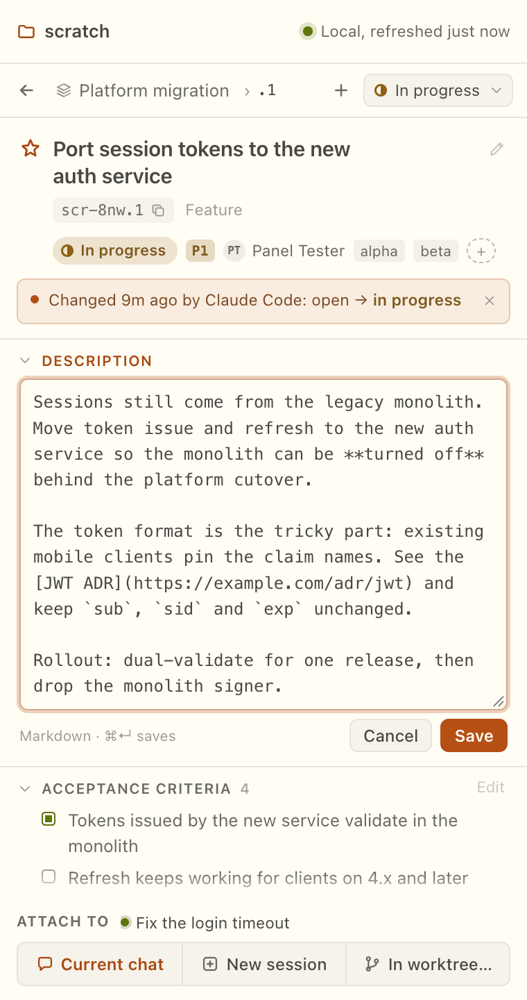

### Status, priority, assignee, labels

- **Status** menu. Moving a bead into a done status asks "Why is it closed?" with an optional reason ("Optional, for example the commit") and **Cancel** or **Mark closed**. Afterwards the panel says "Status set to X." Beads can refuse a close, for example while other beads block it. The panel shows the refusal and does not force it.
- **Priority** menu: Critical, High, Medium, Low, Backlog.
- **Assignee** picker: search a name, choose `Assign to "x"`, or **Unassign**.
- **Labels.** "+ Label" opens a field ("Add a label"). A label cannot be empty, cannot contain a line break, cannot contain a comma or a double quote ("A label cannot contain a comma or a double quote."), and cannot repeat one already on the bead ("That label is already on this bead.").

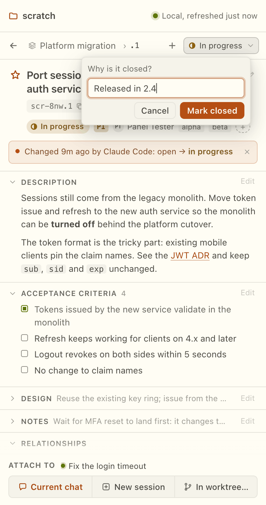

### Links

"+ Add link" takes a kind and another bead ("Bead id or title"; "No bead matches." when nothing fits). Beads keeps one link for each ordered pair of beads, so adding a link of a different kind from A to B is refused while one exists. Remove the old one first, with the "Remove link" button in Relationships. Removal does not ask for a kind.

### Comments

Type in "Add a comment…" and press **Post** ("Posting…" while it runs).

### When someone else changed the bead

Every edit is checked against the bead as you last saw it, down to the field you are changing. If it moved:

- A text edit shows **Changed while you were editing**. You see "Now" (the current text) and "Your draft". **Re-apply** saves yours over it. **Discard** drops yours.
- A one-click change (status, priority and so on) says what it is now, for example "Now status X, …".
- If other parts of the bead changed but the one you edited did not: "Other parts of the bead changed; this one did not. Re-apply to save yours."

### When a write is not certain

- "Saved." The change is in.
- "Saved. Refreshing to show it." The change is in. The panel is reading it back.
- "This may have saved. Refreshing." Beads did not answer in time. The panel reads the bead again and never sends it a second time on its own. Check before you retry.
- "It did not save." with "Your draft is still here." (or "Your comment is still here."). **Try again** sends it again. After a comment that may not have gone in, the button reads **Post again**. After a save it reads **Save again**. After a create, **Create again**.
- "Saved. It may show as a change from someone else." The edit is in, but the panel could not mark it as its own. **Copy** has the detail.

### While Sync is running or has a problem

Editing pauses. The detail says "Editing is paused while Sync runs.", "Editing is paused while Publish runs." or "Editing is paused until the sync problem is resolved." (the last two add "See sync details above."). Your unsaved text stays.

### Due, snooze and defer

Open **More** in a bead's detail. It has two date rows.

- **Due.** "No due date" with **Set due date**. With a date it shows the date, and "Overdue" when it has passed, with **Change** and **Clear**.
- **Deferred.** "Not deferred" with **Defer until…** and **Defer indefinitely**. With a date it reads "Until <date>" with **Change** and **Defer indefinitely**. A bead deferred with no date reads "Until someone brings it back" with **Set a date** and **Undefer**.

The date field takes plain words. The placeholder reads "tomorrow, +3d, 2026-10-20", and the hint adds "next monday". As you type, the panel shows what it understood: "Due <date>" or "Until <date>". The forms it previews are `tomorrow`, `+3d`, `+2w`, `+6h`, `next monday` (any weekday), `2026-10-20` and a full date and time such as `2026-10-20T09:00:00Z`. Units are lowercase. Anything else, such as `+30m`, shows "Beads will read this when you save." Beads may still accept it. The preview is what the panel is sure of, not a rule.

Toasts read "Due <date>.", "Due date saved.", "Due date cleared.", "Deferred until <date>.", "Deferred until someone brings it back." and "No longer deferred." A date edit that meets a change made in the meantime shows **Changed while you were editing** with **Re-apply** and **Discard**, like a text edit.

A bead with a future defer date can be brought back with **Undefer**. The row menu in Needs me also has **Defer** (see [Needs me](#needs-me)).

The filters panel has a **Due** line with **Overdue** ("Not done, and the due date has passed") and **Due this week** ("Not done, and due in the next 7 days").

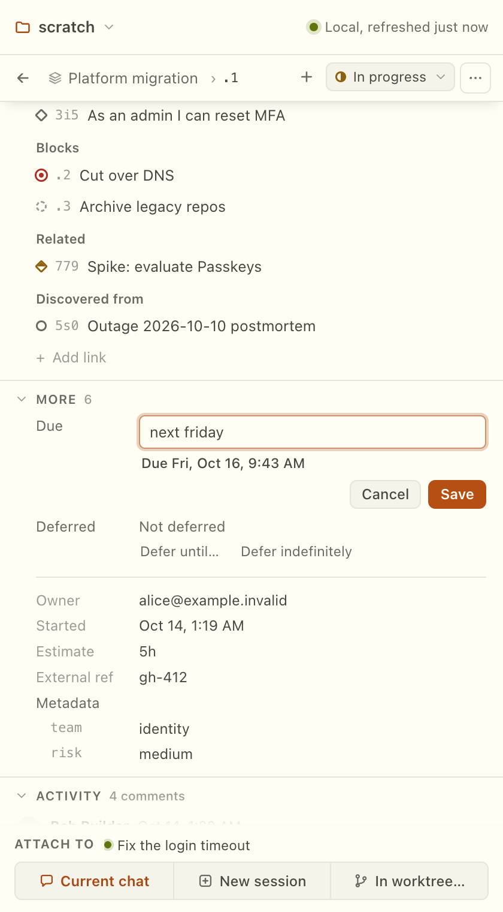

### Moving and retyping

The type chip on a bead opens a menu: "Change the type". The toast reads "Type set to X."

The parent chip opens "Move to an epic" (or "Move to another epic"). It lists **No parent** and the open epics. If there are none, it says "No other open epics in this project." The toasts read "Moved under X." and "Moved out of X." Only epics are offered as parents.

### Acceptance checklist

Items written as `- [ ]` in the acceptance criteria show as checkboxes in the detail. Ticking one rewrites only that line of the text, and it is checked against the bead like any other edit. A bead with no acceptance criteria shows "No acceptance criteria" in its detail.

### Superseded and duplicate

The bead's **Bead actions** menu (the ⋯ button) has **Superseded by…** and **Duplicate of…**. The step asks "Which bead replaces this one?" or "Which bead does this one repeat?", with a "Bead id or title" search ("No bead matches."). The hint reads "Closes <id> and links it to the bead you pick. You confirm first."

Picking a bead shows the question before anything is written: "This closes <id>. It will show as superseded by <id title>." (or "a duplicate of"). **Close as superseded** or **Close as duplicate** writes it. **Choose another** goes back and **Cancel** leaves. The toast reads "Closed X as superseded by Y." If the bead changed while you were choosing: "This bead changed while you were choosing. Nothing was saved. Look it over, then close it again."

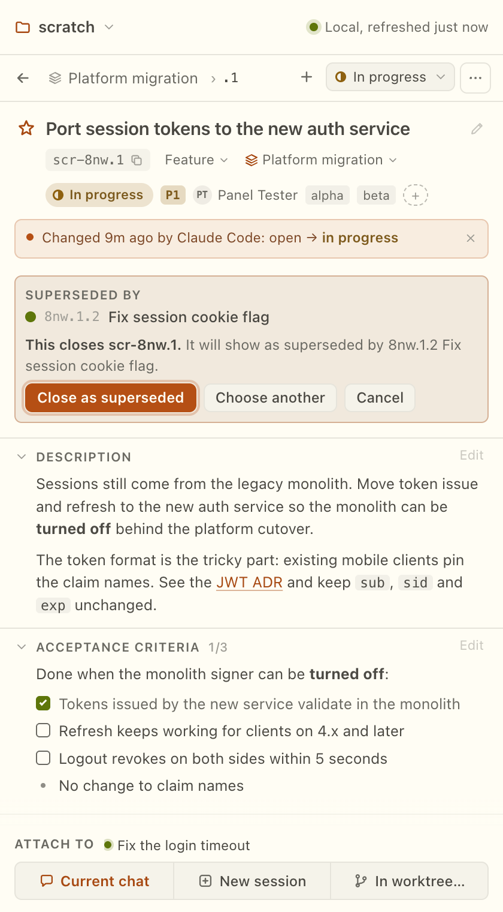

### Closing with a comment and a reason

The close dialog asks "Why is it closed?" and has two optional fields: **Reason** (placeholder "For example the commit") and **Comment** (placeholder "Added to the comments before it closes"). **Cancel** leaves. The button reads **Mark closed** ("Closing…" while it runs). Enter in the reason closes. Cmd+Enter or Ctrl+Enter in the comment closes. Leaving with text typed asks "Discard what you typed?"

The comment goes in first, then the bead closes. If Beads refuses the close, you see "Your comment was added, but the bead could not be closed." followed by the reason, and the comment stays. If the panel cannot tell whether the comment went in, it says "Checking whether your comment went in." and reads the bead again before it does anything else.

### Closing an epic

When every child of an epic is done, the epic shows "All children done" with **Close epic**. In the list the button is quiet. In the epic's detail it is the main button. **Add a reason** next to it opens the close form. The toast reads "Closed <title>." An epic that waits on an open review is not offered, because it cannot close yet. If the epic changed since it was shown: "This epic changed since it was shown. Nothing was saved. Look it over, then close it again."

### Why a bead is not ready

For an open bead the detail has a one-line reason under the status. When the bead is not ready it reads, for example, "Waiting on a review, a timer and k3f2 Fix login" (up to three names, then two and "and N more"), "Snoozed until 2026-10-20", "Snoozed with no date", or "Waiting on something that is not done". An open bead with nothing in the way reads "Ready to start".

## Creating a bead

Press the + button. The "New bead" dialog has:

- **Title** ("What needs doing").
- **Type.**
- **Priority.** Defaults to "P2 Medium".
- **Parent.** "No parent" by default. From a bead's detail it defaults to that bead if it is an epic, else the nearest epic above it. In the Epic view with no bead open, it defaults the same way from the row under your cursor. The choices are epics that are not done.
- **Description** ("Optional. Markdown works.").

**Create** (Cmd+Enter or Ctrl+Enter, shown as "⌘↵ creates") makes the bead and opens it. The toast reads "Created a1b2." If the list does not have it yet: "Created. It will show in the list in a moment." If you close the dialog with text in it, it asks "Discard this bead?"

If the answer to a create is lost, the panel refreshes and does not retry. Look in the list before you create it again.

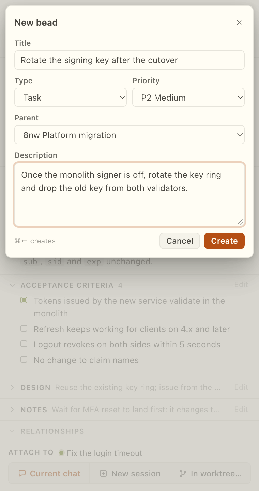

## Giving a bead to your agent

Nothing here sends a message. Each action puts the bead, as a chip with its details, on a composer. You write and send.

From a row menu or the bead detail:

- **Add to current chat.** The chip goes on the open chat's composer. The toast reads "Added a1b2 to the chat." With no chat open the item is disabled and says "No open chat".
- **Start session.** Creates a session linked to the bead, opens it, and puts the chip on its composer. This can take up to 3 minutes. While it runs the buttons read "Starting…".
- **Start in worktree…** Opens "New session in a worktree".

The worktree sheet asks for:

- **Branch and worktree name.** Defaults to `issue-<id>-<slug>`, where the slug is the title in lowercase words joined by dashes, at most 40 characters. Names may use letters, numbers, dots, dashes and slashes, with no spaces: "Use letters, numbers, dots, dashes and slashes, with no spaces."
- **Start from.** Leave empty for the project's default branch.

The sheet says: "The worktree is a separate copy of the project, so your open files stay as they are. Nothing is sent." While it runs: "Making the worktree and starting the session. This can take up to 3 minutes."

OpenChamber closes the panel when a session in another directory becomes the current one, so a worktree start cannot put a chip on the new chat. The session is linked to the bead anyway. When it is done, the sheet's tip says: "The new chat is linked to the bead. To add the bead's details there, type `/bd <id>` in it." There is a **Copy** button for the command.

### The /bd command

In any chat, `/bd <id>` attaches a bead by id. The id can be the full id, or the end of exactly one id after a dash or dot (`a1b2`, or `b2.1` for a child). If more than one bead matches, it says so and lists up to three. If none match: "No bead x in this project." With no id: "Type a bead id after /bd, for example /bd k3f2."

### The + menu

The composer's + menu has a Beads item. It opens a picker: a search box ("Search by id or title"), the beads on the left, and a preview of the highlighted bead on the right. With no search it lists beads that are not done, plus ones closed this week, newest first. **Attach** (or Enter) adds the highlighted bead and closes. It attaches one bead each time it is opened. Empty states: "No open beads." and "No bead has that id or title."

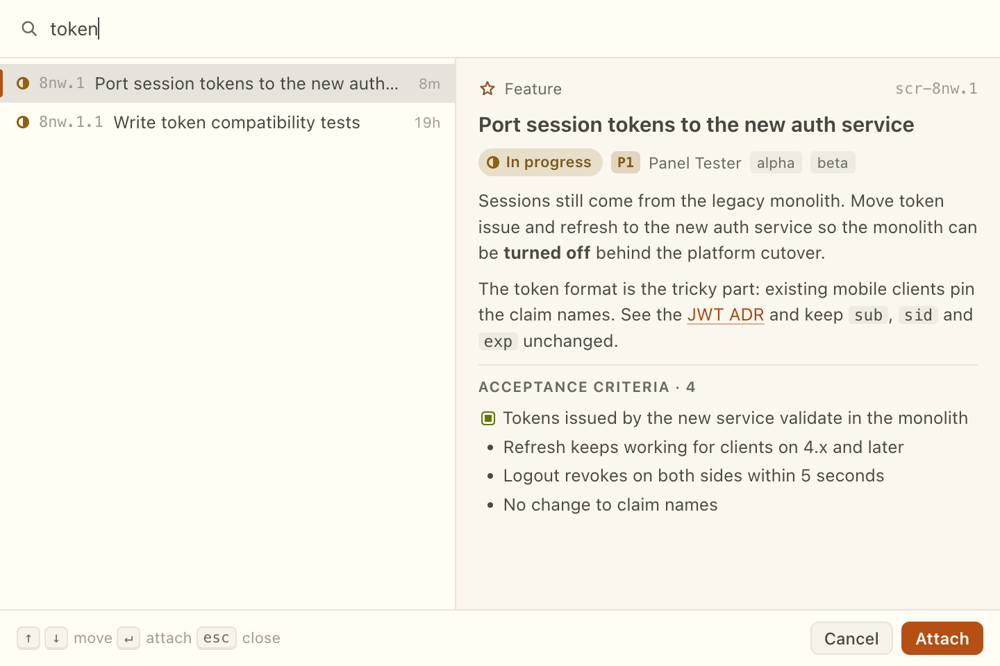

### Chips

Click a beads chip on a composer to see that bead as the project has it now. If it is gone: "<id> is no longer in this project." with "It may have been deleted since it was attached." A chip from another project says "That bead is in another project." with "Open that project to see it."

### Beads with no web page

OpenChamber shows an "Open in the browser" link on every chip and on a session linked to a bead. When the project's git `origin` is on GitHub or GitLab, that link opens the repository page. Otherwise the bead has no web page: it lives only in the project's Beads database on your computer, and the link brings you here.

To see the bead itself, click the chip's title instead of the link. That opens it in the Abacus panel.

## Unseen changes and the rail badge

A bead is unseen when something changed on it that you have not looked at. Unseen beads are highlighted in the list. The rail icon shows how many, and the chip in the tools row shows the same count ("99+" past 99) with the title "Beads changed since you last looked". Click the chip to open Activity.

A bead stops being unseen when you open it. While a bead is open and the panel is visible, changes to it count as seen as they arrive. A change that arrives while the panel is hidden stays unseen, with no banner, until you show it.

Changes you make through the panel do not mark a bead unseen, unless someone else's earlier change on it was still unseen.

**Mark all seen** in the Activity bar clears everything at once. If that fails: "Couldn't mark the changes seen." and the highlights stay.

## Activity

Choose Activity in the view switcher. The feed lists changes newest first, grouped under Today, Yesterday and dates. The bar reads "N changes" and, when some are unseen, "N unseen" with **Mark all seen**. Filters do not apply here. Search does.

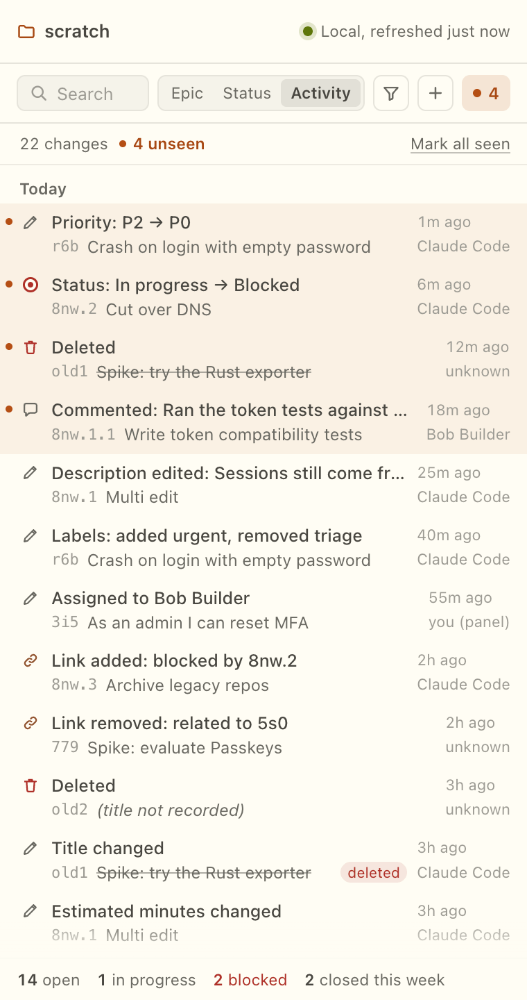

### What an entry says

| Entry | Meaning |
|---|---|
| "Created", "Deleted", "Reopened" | The bead's life. |
| "Closed", "Closed as X · reason" | Closed, with the kind and reason when there is one. |
| "Commented: …" | A comment, trimmed. |
| "Status: A → B" | Status moved. |
| "Priority: P1 → P2" | Priority moved. |
| "Title changed" | The title was edited. |
| "Assigned to X", "Unassigned" | Assignee changed. |
| "Labels: added x, removed y" | Labels changed. |
| "Type: A → B" | Type changed. |
| "Moved under X" | Parent changed. |
| "Link added: blocked by x9", "Link removed: …" | A link changed. |
| "Description edited: excerpt", "Description cleared" | The description was edited. |

A deleted bead shows "(title not recorded)" when its title was never seen, and a "deleted" mark. The feed holds the latest 500 changes.

### Who

Each entry names who made the change:

- **"you (panel)".** The change was made through this panel, by you. This is only when the name Beads recorded for the change is exactly the panel's own: your Git `user.name` (or your computer's user name) followed by " (panel)".
- **A name.** The name Beads recorded, such as your agent's or a teammate's.
- **"unknown".** Beads recorded no name. This is common for changes read from history in embedded mode when `dolt` is not installed.

The panel works out who from Beads' own change log. It does not guess. If one change touches several fields, each field is one entry.

### When

An entry shows when the change was made, as the writer recorded it. If that is unknown, it shows when the panel first saw the change. Entries read from Beads' history show only the day. Hover for detail: "From Beads' history. Only the day is known." or "<full time>, when the panel saw it".

### Activity empty states

- "Nothing has changed yet." with "Changes your agent makes show up here."
- "No changes match." with "Nothing in the activity has that id, title, name or change." and **Clear search**.

The panel keeps its last view of a project between restarts and compares against it, so changes made while the panel was closed still appear. A change that alters a bead's stored version but none of the fields the feed describes can mark it unseen without an Activity row. This is a known limit.

## Needs me

Choose **Needs me** in the view switcher. It lists the beads that are waiting for a person, in four sections. The tab carries a count. When the count is above zero, Needs me is the view the panel opens on. That opening is not saved as your choice: the next time the count is zero, the panel opens on the view you picked before. The count on the rail icon still means unseen beads, not Needs me.

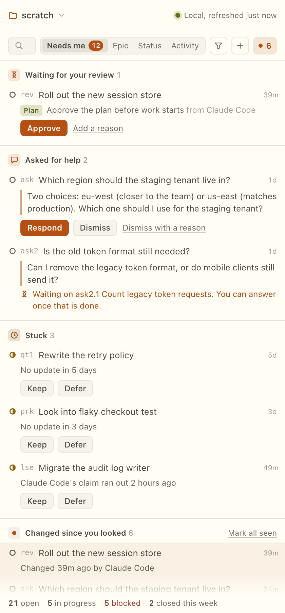

A bead appears once in each section it belongs to. A bead that is both waiting for a review and asking for help is shown under "Waiting for your review" only.

| Section | What is in it | Actions |
|---|---|---|
| **Waiting for your review** | Beads that wait on a review or a plan approval from a person. A tag says **Review** or **Plan**. The reason follows, with "from <creator>" when Beads has one, or "No reason given". "and N more" appears when a bead waits on several. | **Resolve** (**Approve** for a plan), and **Add a reason**. |
| **Asked for help** | Beads an agent labelled `human` to ask a question. The row shows the request text, or "Asked by <name>" or "Asked for help". | **Respond**, **Dismiss** and **Dismiss with a reason**. |
| **Stuck** | Beads in progress with no update for the number of days set in the [project menu](#project-menu), or whose holder's claim has run out. A claim that ran out on a bead that is no longer in progress is not listed. The row says "No update in 5 days" or "<holder>'s claim ran out 2 hours ago". | **Keep** and **Defer**. |
| **Changed since you looked** | Unseen changes, one row per bead, with the newest one described. | **Mark all seen** in the section header. |

The first click does the thing. Each action also has a quieter way to add words: **Add a reason**, or **Dismiss with a reason**.

**Resolve and Approve.** The first click resolves the review. The toast reads "Review resolved for X." or "Plan approved for X." and the row shows "Resolved. Updating the list." or "Approved. Updating the list." until the list catches up. **Add a reason** opens a step titled "Resolve review" or "Approve plan". The hint reads "Resolving lets the bead close." or "Approving lets work on the plan start." If an agent got there first, the panel says so: "The review on X was already resolved by <name> 5m ago."

**Respond.** The step has a "Your answer" box and **Send**. The hint reads "Added as a comment, then the request closes. ⌘↵ sends." The toast reads "Answer sent to X."

**Dismiss.** It closes the request without an answer: "Closes the request without an answer." The toast reads "Request X dismissed." Dismissing leaves no comment, so use **Dismiss with a reason** when the agent should know why.

Respond and Dismiss are not offered while the request is itself blocked by an open bead. The row reads "Waiting on <name>. You can answer once that is done." The panel does not get around that, for the same reason it never forces a close. If the request was answered or closed elsewhere first: "The request X was already answered or closed."

**Keep.** Hides a bead from Stuck for 7 days. Its tooltip reads "Hide it from Stuck for 7 days. Nothing changes in Beads." The toast reads "X is hidden from Stuck for 7 days." The hiding is kept on this computer and changes nothing in the project. It returns on its own after 7 days if the bead is still stuck.

**Defer.** Opens a "Defer until" date field, with the same plain-word dates as in [Due, snooze and defer](#due-snooze-and-defer). The toast reads "X deferred until <date>."

**Changed since you looked.** A review that an agent resolved shows up here, not in Waiting, because there is nothing left for you to do. Open the bead to clear it.

The search box narrows Needs me by id, title or reason. "Nothing here matches." means no row fits and "No bead in Needs me has that id, title or reason." says what was searched. With nothing in any section, the view reads "Nothing needs you right now." The keyboard works as in the list: J and K move, Enter opens.

## Waiting on and reviews

A review or a plan approval is a bead that something else cannot close or start until a person says so. Beads calls the thing that holds it a gate. The panel only uses the word where Beads does. Agents see the same gates, because they live in the project.

### Asking for a review

Open the bead's **Bead actions** menu (the ⋯ button):

- **Ask for a review.** The bead cannot close until someone resolves the review.
- **Ask for plan approval.** Work waits until someone approves the plan.
- **Ask with a reason…** The same, with your own words first.

The Design section also has **Ask for plan approval** ("Ask for approval of this plan before work starts").

The step has a switch between **Review** and **Plan approval**, and a "Reason (optional)" field. A review's reason starts as "Review before closing". The hints read "The bead cannot close until someone resolves the review. Agents see it too." and "Work waits until someone approves the plan in Design. Agents see it too." A reason is one line of up to 500 characters. A plan approval's reason always starts with fixed words, so the panel and agents can tell it from a review.

The toasts read "Review asked for on X." and "Plan approval asked for on X." If the bead already waits on one: "This bead already waits on a review." or "This bead already waits on a plan approval."

### The Waiting on section

A bead that waits on something shows a **Waiting on** section in its detail, with a count when there is more than one. Each line has a tag (Review, Plan approval, Timer, GitHub run, GitHub pull request, Bead or Check), the reason or "No reason given", and a state line:

- A review or plan: "Asked by <name>, 5m ago".
- A timer: "Ends in 2h. Set by <name>." When it has run out: "Time is up. Beads clears it on its next check."
- A GitHub check: "Beads checks GitHub for it."

Reviews and plan approvals have **Resolve** (**Approve** for a plan) and **Add a reason**. The reason step reads "Reason for resolving" or "Reason for approving". The hints read "Resolving lets the bead close." or, when other things also wait, "Resolving clears this review. The bead still waits on the rest." Afterwards: "Resolved. Updating." or "Approved. Updating." If an agent resolved it first: "This review was already resolved by <name> 5m ago. Updating."

Timers, GitHub checks and bead waits are read-only in the panel. Beads clears them itself.

### Closing a bead that waits on a review

Beads refuses the close, and the panel shows why: "This bead can't be closed yet. It is waiting on a review. Resolve the review first." For a plan it says "Approve the plan first." and for several, "Resolve them first." If you closed with a comment, the comment is still added. See [Closing with a comment and a reason](#closing-with-a-comment-and-a-reason).

The review itself is stored by Beads as a bead of its own. The panel keeps those out of the Epic and Status lists and counts, so a review never shows up as a second bead to work on.

## History and Restore

The **History** section in a bead's detail shows what the bead looked like before. It opens on click and reads only then, so it costs nothing until you ask. It goes back as far as Beads keeps versions, and shows the newest first, grouped under Today, Yesterday, dates and Earlier. "Reading history…" shows while it loads. When there is more: **Load older**. When there is none: "No earlier versions."

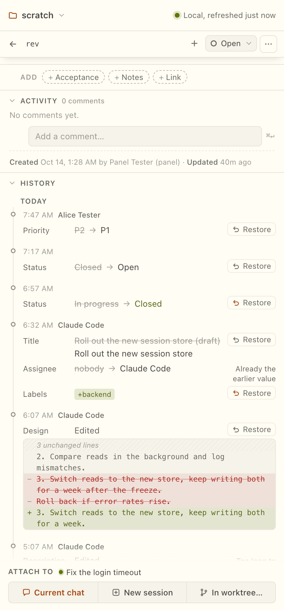

An entry starts with "Created" or the field that changed: Title, Status, Priority, Type, Assignee, Labels, Description, Design, Acceptance, Notes or Close reason. Short values read "from → to". A text field reads "Edited", "Added" or "Cleared" with a compact diff of the lines that changed: "N unchanged lines" stands in for the runs that did not, with **Show N more lines** to open them. "Only the start of this text is shown." means a very long text was cut.

Reviews, plan approvals, timers and checks show as plain events: "Review requested", "Review resolved by <name>" (or "someone else"), "Review deleted", "Review removed from this bead", "Plan approval requested", "Plan approved", and so on.

**Who.** An entry names who made the change when Beads recorded it on this computer. Otherwise it reads "someone else or another computer". The tooltip reads "Beads keeps who made a change only on the computer where it was made." A close and a reopen carry no name at all, because Beads does not record one it can tie to a version. Label changes are not listed: "Label changes are not listed: Beads has no record of them on this computer."

If the bead changes while you read, the section says "This bead changed since its history was read." with **Refresh**.

### Restore

A field that can be put back has a **Restore** button ("Put the earlier <field> back"). You can restore the title, status, priority, assignee, labels, description, design, acceptance and notes. Closing, reopening and the other fields are read-only here. While it runs the button reads "Restoring…" and afterwards the toast reads "Restored the earlier <field>."

Restore is a normal edit: it is checked against the bead as it is now, and recorded as you.

- If the field is already at that value, the entry says "Already the earlier value".
- If the text is very long and only its start was read, the entry says "Too long to restore here". Its tooltip reads "Only the start of this text is shown here, so it cannot be put back from here."
- If the field was changed again since, the tooltip reads "The <field> was changed again since. You choose before anything is written." Pressing Restore does not write. It shows what would change: for a text, "Restoring would change it like this:" with the diff, and for a short value both values. **Restore anyway** writes it. **Keep current** leaves it.
- If the bead changed since it was shown, nothing is written: "This bead changed since it was shown. The <field> is still X. Nothing was changed."

**From Activity.** An Activity row's menu has **Restore** for a change you want to undo, with the same checks. It is how you put back what an agent changed without opening the bead.

## Memories

Memories are short notes that Beads puts at the start of every agent session in the project. They are how you tell agents something once. Because every session reads them, a wrong memory costs more than a wrong comment, so the panel never overwrites one without showing you what is there now.

Open them from the [project menu](#project-menu): the project name in the header, then **Memories**. The page is titled "Memories" with a count, and starts with "Every agent session in this project starts with these." It has **Add**, a **Back** button, and a search box ("Search memories"). The newest change comes first.

Each memory shows its name and text, **Edit** and **Forget**, and "Changed 2h ago by <name>" when Beads knows. Empty: "No memories yet." with "Add one and every agent session in this project starts with it." No match: "No memory matches." with **Clear search**.

**Add.** The form has a "Memory" box and a "Name (optional)" field. The hint reads "Leave the name empty and Beads makes one from the text. ⌘↵ adds." Cmd+Enter or Ctrl+Enter in the text box adds. Enter there makes a new line. Enter in the Name field adds. The button reads **Add memory**.

Refusals say nothing was saved:

- "A memory needs some text."
- "A memory is at most 4,000 characters. Shorten it; nothing was saved." Beads does not cut it.
- "A memory named X already exists. Nothing was saved." with **Replace it with mine**.
- "That text is the name of another memory. Reword it so it reads as an instruction." This happens when the text alone is another memory's name.
- The name `schema_version` is refused, because Beads uses it for itself.

**Edit.** The box is "New text", with the hint "⌘↵ saves. The text above stays until you save." **Save** or **Cancel**. If the memory changed elsewhere while you were editing: "<name> changed elsewhere while you were editing. Nothing was saved." You see "Now in Beads", with **Save mine anyway** and **Keep current**. If it was removed: "This memory was removed elsewhere. Nothing was saved. Add it again with your text, or discard it." with **Add it again** and **Discard**.

**Forget.** A step titled "Forget <name>?" shows the text, and says "Every agent session in this project will stop seeing this." **Forget memory** or **Cancel**. If the memory changed since you opened the step, nothing is forgotten: "This memory changed since you opened this step. This is its text now; nothing was forgotten."

**Undo.** After a forget the bar says "Forgot <name>." with **Undo**. Undo puts back the same name and text, and the bar says "<name> is back." If something took the name meanwhile: "Could not bring back <name>: a memory with that name exists now. Nothing was saved. Its text was:" followed by the text, so you can copy it.

Leaving with unsaved text asks "Discard your unsaved text?" ("What you typed here goes. Saved memories stay as they are."), "Discard your changes?" or "Discard this memory?", each with **Keep editing** and **Discard**.

If a read fails after the page is open: "Could not read the memories again: …" and the list shows what was last read.

## Project menu

Press the project name in the header. The menu has **Memories** ("What every agent session here starts with") and a **Settings** block.

### Stuck days

"Stuck after N days". A whole number from 1 to 30, 3 by default. The hint reads "Work in progress with no update for this long shows under Stuck in Needs me. Kept on this computer, for this project." Anything else says "Enter a whole number of days from 1 to 30." It is not shared with the team and does not change the project.

### Live updates

By default the panel checks for changes every few seconds. With Beads 1.3 or later it can instead follow a log that Beads keeps and refresh the moment something is written. The row shows **On**, **Off** or **Checking** and a line under it:

| State | Line |
|---|---|
| On | "Following changes as they happen." |
| On, but the follower dropped | "Reconnecting. Until then, the panel checks for changes every few seconds." |
| On, but it cannot run | "Not working right now, so the panel checks for changes every few seconds." |
| Starting | "Starting. Until then, the panel checks for changes every few seconds." |
| Off | "Off for this project, so the panel checks for changes every few seconds. Turn it on to see changes as soon as they happen." |
| Beads older than 1.3 | "Needs a newer version of Beads (1.3 or later). Until then, the panel checks for changes every few seconds." |

The panel never turns live updates on by itself. **Turn on live updates** asks first: "Turn on live updates?" It says "Beads will keep a log of changes on this computer for 7 days." and "This changes the project's settings file, .beads/config.yaml, which is shared with your team if you commit it." **Cancel** or **Turn on** ("Turning on…" while it runs). This is the one place the panel changes Beads' configuration, and only after you confirm. The other change it can make to a project is [Update project](#a-project-that-needs-a-one-time-update). The log itself stays on this computer. If you commit `.beads/config.yaml`, teammates get the setting too; until their Beads starts the log, their panel keeps polling.

If Beads did not confirm the change: "Live updates may be on now, but Beads didn't confirm it." The panel reads the setting again and shows the result. If it cannot read the setting: "Couldn't read this setting for the project." with **Try again**. While a sync runs: "Wait for the sync to finish, then try again." Polling keeps working in every state, so a failure here never leaves the list stale.

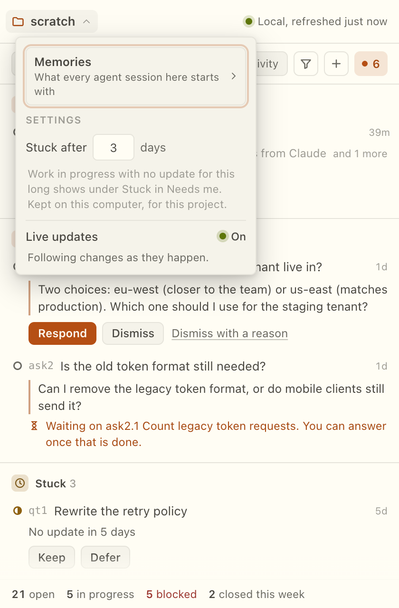

## Sync and Publish

Sync and Publish appear only for a project with a shared copy with the team (a Dolt remote). Beads keeps the team's copy separate from your Git remote.

- **Sync** (the sync icon, "Sync: get the team's latest changes") brings in the team's changes. It never sends yours. While it runs: "Syncing with the team…".
- **Publish** sends yours. It first opens a review sheet.

Both are refused while the other is running: "Sync didn't start because a sync is running. Try again when it finishes." Your agent may also sync or publish. The Publish button's tooltip says: "Your agent may also publish these when it syncs."

When Sync finishes: "Synced."

### The Publish sheet

"Publish to the team" opens with "These changes go to the team's shared copy." while it reads "Reading what would be published…". Then it lists the changes that are on this computer and not on the team's copy: a summary of each, who made it, and when. The list shows up to 1,000 and ends with "and N more" beyond that.

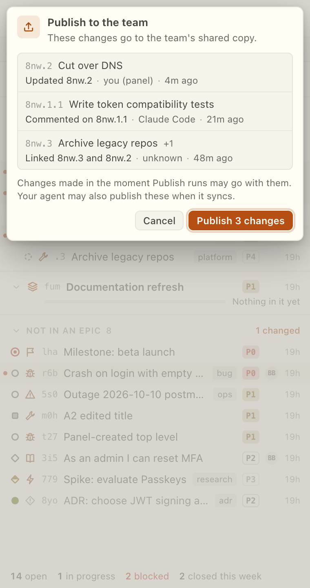

Cases where the sheet has nothing to confirm:

- "This project has no shared copy with the team, so there is nothing to publish."
- "Nothing to publish. Everything here is already on the team's shared copy."
- "The team's shared copy has nothing in it yet. Publish can't set it up."
- "This computer hasn't seen the team's shared copy yet. Sync first."
- "Couldn't confirm this list is current. Close and try again." (The sheet could not read the point in history the list was taken from, so Confirm is off.)

**Publish N changes** is ignored for half a second after it appears, so a stray click cannot send it. If new changes arrive while the sheet is open, it is refreshed with a notice and focus does not land on Confirm.

When you confirm, Publish first pulls the team's changes, then pushes. It sends only what you saw. If anything new is on your side by then, it stops and says "New changes arrived since you looked. Review them again." Toast: "Published N changes."

**A small window remains.** Right before it pushes, Publish checks that only the changes you reviewed will go. A change written in the few milliseconds between that check and the push can still go along. Your agent writes outside the panel and Dolt cannot push up to a named commit, so this cannot be closed from here. The sheet says it: "Changes made in the moment Publish runs may go with them."

### When Sync needs attention

A card appears when a sync could not finish.

- **"Sync needs attention".** Both sides edited the same field of a bead. "Your changes are safe. The team's copy has edits to the same fields." and "Editing is paused until this is resolved." Beads backed the merge out. Different fields of one bead merge on their own and never conflict.
- **"Sync ran into a problem".** Something else failed. It can be dismissed.
- **"Sync is paused".** Beads refused the data's format or version: "This project's beads data needs a different Beads version. Hand it to your agent to check."

The card can list the beads involved ("Show the bead" or "Show the N beads", then "Hide beads" and "Show N more") and, for each field, the Local and Team values, with "Show all" and "Show less" for long ones. If it cannot tell which beads: "Couldn't tell which beads are affected. Copy details has the full record."

Actions:

- **Hand to agent** with a chat open. It puts the details on the composer. The hint is "Nothing is sent until you send it."
- **Start session with this** with no chat open. The hint is "No open chat."
- **Copy details.**

The details carry both sides of the conflict, what failed, the commands Beads ran, and the rules from the project's `AGENTS.md` about syncing, when it has any. The panel never resolves a conflict for you. The card clears once the team's copy has nothing the local copy lacks, usually after your agent merges it.

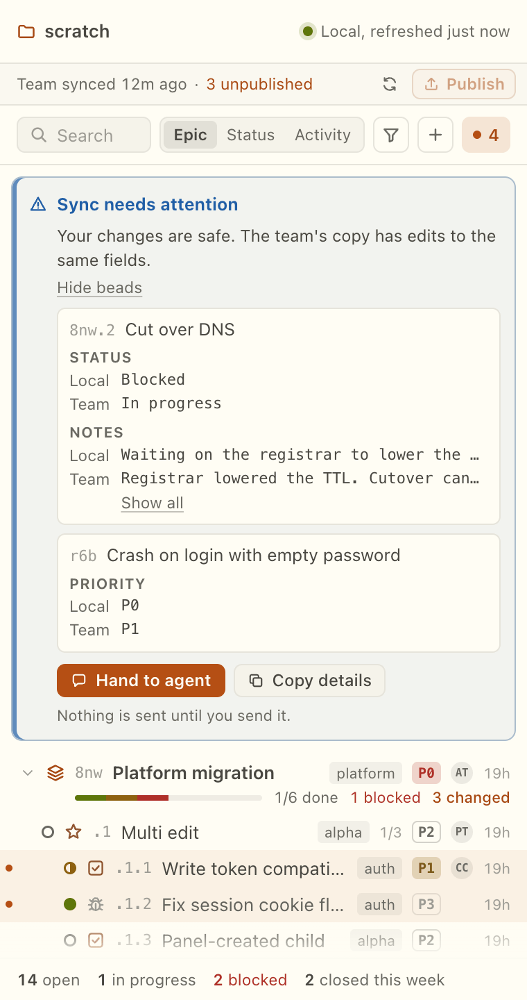

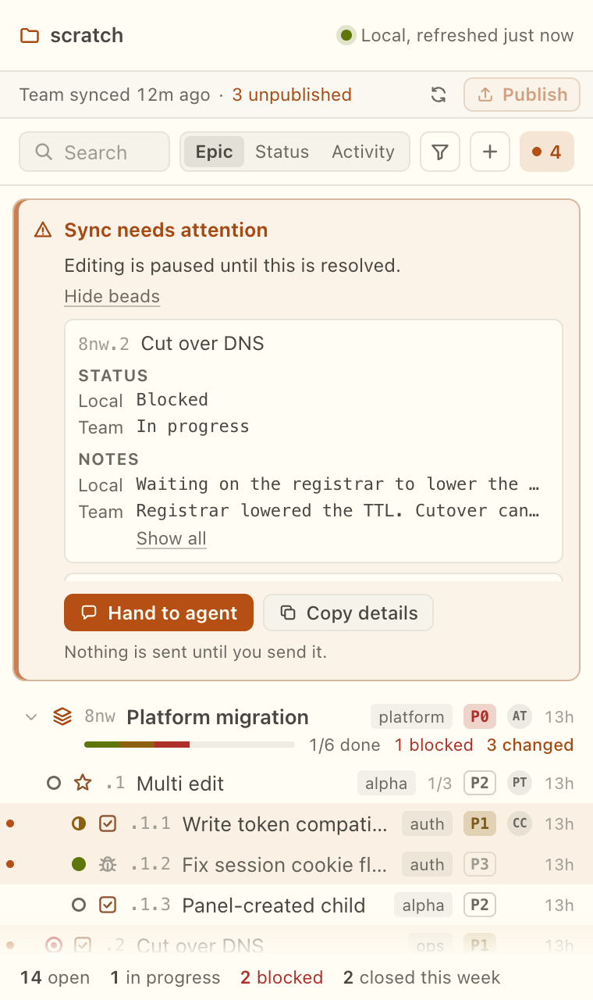

## A project that needs a one-time update

A project last written by an older Beads cannot be read by the Beads that is installed now. Instead of the list, the panel says "This project needs a one-time update for the newer Beads." and "It was made with an older version of Beads, and Abacus can't read its beads until it's updated." Nothing is written until you ask.

**Update project** opens a confirm: "Update this project?" It says "Beads updates this project's data to the new format. This happens once." "Your beads themselves don't change." and "Tools that use an older Beads may not open this project afterwards." Press **Update** to go ahead or **Cancel**. Escape cancels too, except while the update runs.

The update runs in the background and the panel says "Updating this project. This can take a minute or two." It has two minutes. You can close the panel or switch project meanwhile; the panel shows where it stands when you come back. While it runs, and until the project is updated, every other change is refused. When it is done the list comes back and focus goes to it.

This is the second thing the panel can change in Beads, after [Live updates](#live-updates). It never happens on its own.

| What the panel says | What it means |
|---|---|
| "This project shares its beads with your team, so Beads won't update it from here. Ask whoever set up the team copy to update it, or update it on the computer that hosts it." | The project is shared through a team copy or a server. Beads will not update it in place, and the panel never forces it. There is no retry button. **Details** has the technical text. |
| "The update may have finished, but Beads didn't confirm it. Reading the project again." | Beads did not say how it ended. The panel reads the project again; **Check again** does it once more. |
| "This project still needs the update." | **Check again** found the project unchanged. Press **Update project** to try again. |
| "Beads is busy. Nothing was saved. Try again in a moment." | Another Beads command held the project. **Try again** sends it at once. |

For causes and fixes see [troubleshooting](troubleshooting.md#the-project-cannot-be-shown).

## When a project cannot be shown

These replace the list. Each has a fix in [troubleshooting](troubleshooting.md).

When Beads is missing or too old, **Ask the agent to install Beads** (or **Ask the agent to update Beads**) puts a short request on the chat's message box. Nothing is sent until you send it; with no chat open, it opens a new one. Abacus cannot see what is in the message box, so after that the button says **Added to the chat** and does not add the request again. If you removed it, press **Add it again** next to it. Opening another chat, pressing **Retry** or leaving the screen brings the Ask button back. To do it yourself, **Copy install command** (or **Copy update command**) and **Install guide** are right below. Press **Retry** once Beads is in place. The attach dialog shows the same screen without the Ask button; ask from the Abacus panel instead.

| Message | Screen |
|---|---|
| "Beads isn't installed on this computer." | [no-bd](screenshots/no-bd-light.png) |
| "This version of Beads is too old." | [bd-too-old](screenshots/bd-too-old-light.png) |
| "This project doesn't use Beads." | [no-workspace](screenshots/no-workspace-light.png) |
| "This project uses an older Beads format." | [pre-dolt](screenshots/pre-dolt-light.png) |
| "Open this project with Beads X?" | [needs-first-contact](screenshots/needs-first-contact-light.png) |
| "This project's Beads server isn't running." | [server-down](screenshots/server-down-light.png) |
| "Couldn't load this project's beads." | [load-error](screenshots/load-error-light.png) |
| "Open a project to see its beads." | No project is open. |
| "Beads can't open this project right now." | Beads could not say why. |

While the first read runs the panel shows a skeleton labelled "Loading beads".
